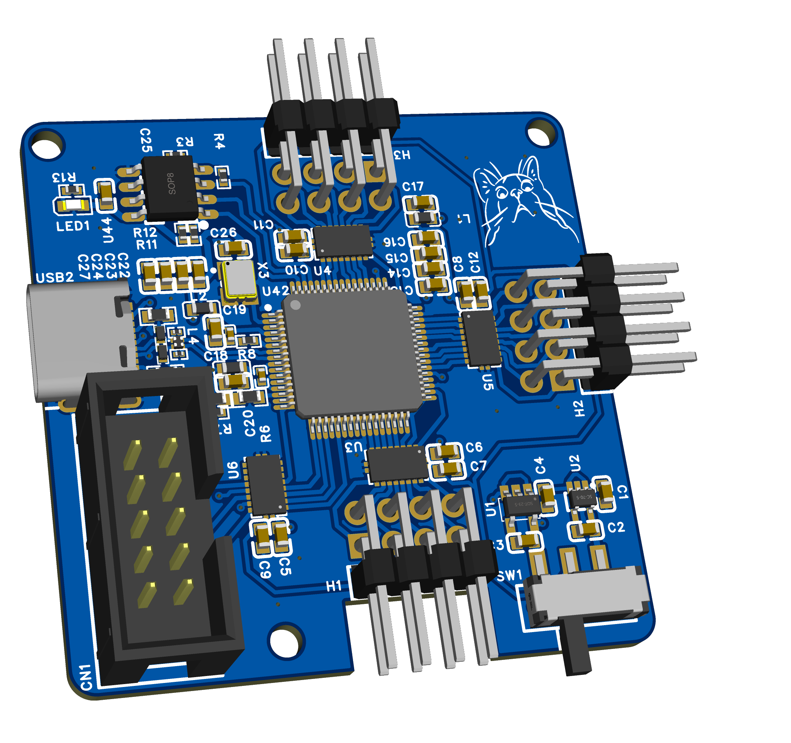
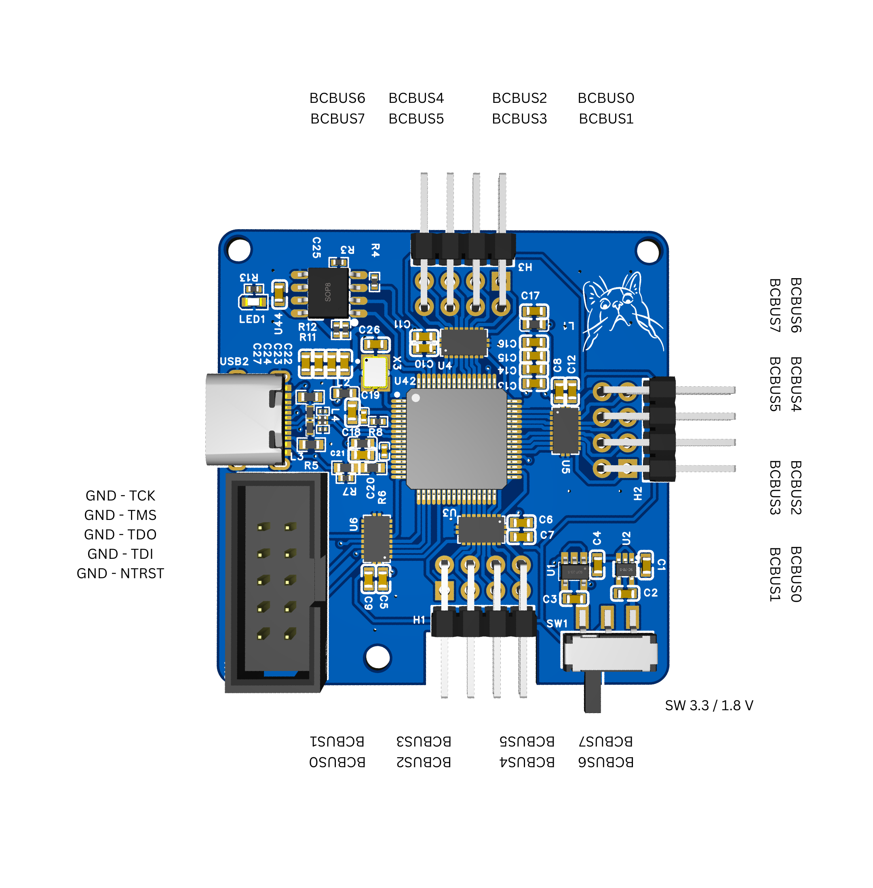

# FT4232H-USB-C-DONGLE

An open-source USB-C flash/debug interface adapter built for our Stardance projects.

<p align="center">
  
</p>

---

## Features

- FT4232H High-Speed USB Interface
- USB-C connectivity
- On-board EEPROM
- 4 Debug/Communication Connectors
  - 1× Standard 10-pin JTAG
  - 3× Additional buses
- Selectable **1.8 V / 3.3 V** logic levels for the additional buses
- Open-source hardware

---

## How to Use

- Connect the adapter , use FTPROG to flash the eeprom .
- Run the PY file , if needet install the serial module (python -m pip install pyserial)
- The rest of the procces is explained in the Py file when run...


---

# PCB

<p align="center">
  
</p>

---

# Pinout

<p align="center">
  
</p>

---

# Pricing

| Item | Price |
|------|------:|
| PCB Assembly (JLCPCB, incl. shipping) | **€128.24** |
| CNC / 3D Printed Case | **Coming Soon** |

> Prices are prototype costs and may decrease significantly in larger production quantities.

---

# Repository Contents

```
Case CAD/
 ├── Case.step
 └── case.png

PCB/
 ├── BOM.xlsx
 ├── Gerber.zip
 ├── PCB.png
 ├── PickAndPlace.xlsx
 └── SCH.epro2

LICENSE
PINS.png
README.md
```

---
